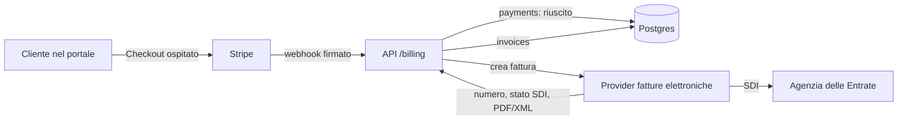

# Conformità fiscale e privacy

Regole durevoli per dati aziendali, pagamenti, fatture e fornitori. Il codice prevale; questa pagina dice cosa non si fa mai.

## Profilo aziendale

- Fonte unica: `packages/shared/src/company.ts` (`COMPANY`, `vatLabel()`, `isFiscallyActive()`).
- Forma prevista: ditta individuale di Lorenzo Garoffolo, regime forfettario; collaboratori (Mirko) autorizzati al trattamento (art. 29 GDPR).
- Nessun dato fiscale inventato: finché `vatNumber`, `taxCode` e `registeredOffice` sono `null`, l'interfaccia mostra «P.IVA in fase di attribuzione».
- Usano il profilo: informativa, footer, contratto, email, riepilogo del portale, area admin. Pagamenti online e registrazione fatture si attivano da soli quando `isFiscallyActive()` è vero (P.IVA, C.F., sede).

## Preventivo, valuta e calcoli

- Fonte unica dei calcoli: `packages/shared/src/billing.ts` (`computeQuote`): niente IVA (forfettario), bollo 2 € per fattura sopra 77,47 € addebitato al cliente, acconto 50% + saldo 50%, canoni mensili a parte.
- Valuta per progetto (`projects.currency`, migrazione `0010`): EUR o USD, mai convertita. USD = documenti in inglese. Il selettore IT/EN del portale cambia solo la lingua dell'interfaccia.

## Flusso di vendita

1. Il team prepara progetto e preventivo (valuta, voci, scadenza acconto) e invita il cliente.
2. Il cliente firma il contratto dal portale. Da quel momento preventivo, valuta e cliente sono bloccati (409).
3. Entro `INVOICE_WITHIN_DAYS` (10) giorni dalla firma: fattura dell'acconto + link di pagamento. Prima della fattura non è dovuto nulla (art. 2.3 del contratto).
4. Incasso: Stripe Checkout (webhook firmato) oppure bonifico registrato dal team. Fattura emessa sul servizio di fatturazione e registrata in admin.

## Pagamenti e fatture

- Tabelle `payments` e `invoices` (migrazione `0009`). Una fattura punta al pagamento che la origina.
- Lo stato «pagato» lo scrive solo il server da webhook firmato; `(provider, provider_payment_id)` univoco = webhook idempotente.
- Numero progressivo, data, stato SDI, PDF e XML arrivano solo dal provider di fatturazione: l'app non numera mai fatture e il browser non emette documenti fiscali.
- API: `GET /billing/summary|payments|invoices` (team e cliente); `POST /billing/checkout` (cliente, importo calcolato dal server, solo dopo la firma e con P.IVA + Stripe); `POST /billing/payments` (team, bonifico); `POST /billing/invoices` (team, solo con P.IVA). Webhook Stripe su `POST /api/webhooks/payments` (corpo grezzo, firma HMAC verificata, idempotente, controllo importo/valuta).
- Env: `STRIPE_SECRET_KEY`, `STRIPE_WEBHOOK_SECRET` (eventi `checkout.session.completed`, `checkout.session.async_payment_succeeded`, `checkout.session.expired`, `checkout.session.async_payment_failed`).
- Ruolo `cf_app`: niente `DELETE` su `contract_signatures`, `payments`, `invoices` (registri da conservare 10 anni).
- Forfettario: niente IVA in fattura, dicitura di franchigia (L. 190/2014), bollo 2 € sopra 77,47 €; clienti extra UE con codice destinatario `XXXXXXX`; ritenuta non applicata.
- Clienti USA: eventuale W-8BEN ufficiale IRS (persona fisica), firmato dal titolare, solo su richiesta del cliente. Mai certificati fiscali generati dall'app.

## Firma del contratto

- Testo canonico in `packages/shared/src/contract.ts` (`buildContract`, `CONTRACT_VERSION`): la stessa funzione genera la pagina del portale e, sul server, il testo firmato (contratto + Allegato A con il preventivo).
- Alla firma (solo ruolo `client`, una volta per versione) si salvano in `contract_signatures`: testo integrale e SHA-256 in `metadata`, firmatario, email, IP, user agent, data. Copia del testo con i dati della firma inviata via email a cliente e studio.
- Cambiare il testo = nuova `CONTRACT_VERSION` (le firme precedenti restano valide per la loro versione).
- Conservazione: 10 anni dalla fine del rapporto.

## Database in UE (Neon)

Neon non sposta un progetto esistente di regione: si crea un progetto nuovo e si copiano i dati.

1. Console Neon → nuovo progetto in **AWS Europe (Frankfurt) `aws-eu-central-1`**, stessa versione Postgres.
2. Finestra di manutenzione: nessun deploy durante la copia.
3. Copia (con la stringa owner del vecchio e del nuovo progetto, mai nel repo):
   `pg_dump --format=custom --no-owner --no-acl "$OLD_OWNER_URL" > cf.dump`
   `pg_restore --no-owner --no-acl --dbname "$NEW_OWNER_URL" cf.dump`
4. Nel nuovo progetto: creare il ruolo `cf_app` con password nuova e ridare i grant DML su tutte le tabelle (come in produzione oggi, più quelli delle migrazioni `0003` e `0009`).
5. Aggiornare `DATABASE_URL` (ruolo `cf_app`) nelle env Vercel di produzione e il secret GitHub `DATABASE_URL` (owner, per le migrazioni).
6. Deploy, smoke test (login admin, portale cliente, lead dal form), confronto conteggi righe per tabella.
7. Aggiornare l'informativa (sezione fornitori: Neon in UE) e tenere il vecchio progetto in sola lettura qualche giorno, poi eliminarlo.

## Fornitori: contratti per il trattamento dei dati (art. 28)

| Fornitore | Ruolo | Azione |
|---|---|---|
| Vercel | hosting, Blob | DPA incluso nei termini: scaricare e archiviare la copia |
| Neon | database | DPA incluso nei termini: scaricare e archiviare; verificare la regione dopo la migrazione |
| Resend | email | DPA incluso nei termini: scaricare e archiviare |
| Stripe | pagamenti | DPA incluso nel contratto di servizio; Stripe è anche titolare autonomo per antiriciclaggio |
| Provider fatture elettroniche | emissione, SDI, conservazione | nomina a responsabile nel contratto del servizio |
| Apify, Groq | prospezione | DPA dei rispettivi termini: archiviare |
| Commercialista | contabilità | lettera di nomina a responsabile (art. 28) |
| Telegram | notifiche interne | nessun dato personale nei messaggi (vincolo di `lib/notify.ts`) |

Tenere anche un registro dei trattamenti (art. 30) semplice, coerente con l'informativa.
