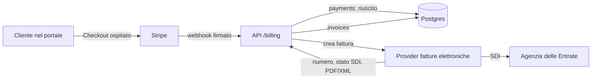

# Conformità fiscale e privacy

Regole durevoli per dati aziendali, pagamenti, fatture e fornitori. Il codice prevale; questa pagina dice cosa non si fa mai.

## Profilo aziendale

- Fonte unica: `packages/shared/src/company.ts` (`COMPANY`, `vatLabel()`, `isFiscallyActive()`).
- Forma prevista: ditta individuale di Lorenzo Garoffolo, regime forfettario; collaboratori (Mirko) autorizzati al trattamento (art. 29 GDPR).
- Nessun dato fiscale inventato: finché `vatNumber`, `taxCode` e `registeredOffice` sono `null`, l'interfaccia mostra «P.IVA in fase di attribuzione».
- Oggi usano il profilo: informativa privacy e footer. Da collegare: contratto, email transazionali, riepilogo preventivo nel portale (vedi punti aperti in `current-status.md`).

## Pagamenti e fatture

- Tabelle `payments` e `invoices` (migrazione `0009`). Una fattura punta al pagamento che la origina.
- Lo stato «pagato» lo scrive solo il server da webhook firmato; `(provider, provider_payment_id)` univoco = webhook idempotente.
- Numero progressivo, data, stato SDI, PDF e XML arrivano solo dal provider di fatturazione: l'app non numera mai fatture e il browser non emette documenti fiscali.
- API in sola lettura: `GET /api/projects/:id/billing/payments` e `/invoices` (team e cliente del progetto; id e metadati del provider non esposti).
- Ruolo `cf_app`: niente `DELETE` su `contract_signatures`, `payments`, `invoices` (registri da conservare 10 anni).
- Forfettario: niente IVA in fattura, dicitura di franchigia (L. 190/2014), bollo 2 € sopra 77,47 €; clienti extra UE con codice destinatario `XXXXXXX`; ritenuta non applicata.
- Clienti USA: eventuale W-8BEN ufficiale IRS (persona fisica), firmato dal titolare, solo su richiesta del cliente. Mai certificati fiscali generati dall'app.

## Firma del contratto

- Tabella `contract_signatures` (migrazione `0009`): firmatario, email, IP, user agent, data, versione, testo del consenso.
- Conservazione: 10 anni dalla fine del rapporto. Da migliorare: hash calcolato sul testo integrale del contratto firmato.

## Database in UE (Neon)

Neon non sposta un progetto esistente di regione: si crea un progetto nuovo e si copiano i dati.

1. Console Neon → nuovo progetto in **AWS Europe (Frankfurt) `aws-eu-central-1`**, stessa versione Postgres.
2. Finestra di manutenzione: nessun deploy durante la copia.
3. Copia (con la stringa owner del vecchio e del nuovo progetto, mai nel repo):
   `pg_dump --format=custom --no-owner --no-acl "$OLD_OWNER_URL" > cf.dump`
   `pg_restore --no-owner --no-acl --dbname "$NEW_OWNER_URL" cf.dump`
4. Nel nuovo progetto: creare il ruolo `cf_app` con password nuova e ridare i grant DML su tutte le tabelle (come in produzione oggi, più quelli delle migrazioni `0003` e `0009`).
5. Aggiornare `DATABASE_URL` (ruolo `cf_app`) nelle env Vercel di produzione e il secret GitHub `DATABASE_URL` (owner, per le migrazioni).
6. Deploy, smoke test (login admin, portale cliente, lead dal form), confronto conteggi righe per tabella.
7. Aggiornare l'informativa (sezione fornitori: Neon in UE) e tenere il vecchio progetto in sola lettura qualche giorno, poi eliminarlo.

## Fornitori: contratti per il trattamento dei dati (art. 28)

| Fornitore | Ruolo | Azione |
|---|---|---|
| Vercel | hosting, Blob | DPA incluso nei termini: scaricare e archiviare la copia |
| Neon | database | DPA incluso nei termini: scaricare e archiviare; verificare la regione dopo la migrazione |
| Resend | email | DPA incluso nei termini: scaricare e archiviare |
| Stripe | pagamenti | DPA incluso nel contratto di servizio; Stripe è anche titolare autonomo per antiriciclaggio |
| Provider fatture elettroniche | emissione, SDI, conservazione | nomina a responsabile nel contratto del servizio |
| Apify, Groq | prospezione | DPA dei rispettivi termini: archiviare |
| Commercialista | contabilità | lettera di nomina a responsabile (art. 28) |
| Telegram | notifiche interne | nessun dato personale nei messaggi (vincolo di `lib/notify.ts`) |

Tenere anche un registro dei trattamenti (art. 30) semplice, coerente con l'informativa.
