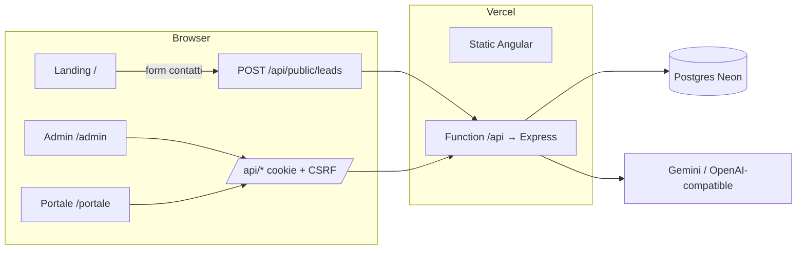
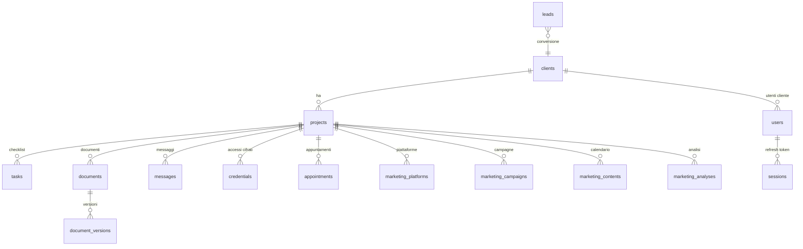

# Architettura di sistema

## Vista d'insieme

Stesso dominio per sito e API: i cookie di sessione restano first-party (`SameSite=Lax/Strict`, `HttpOnly`, `Secure` in produzione).

## Componenti

| Componente | Responsabilità | Sorgente |
|---|---|---|
| `packages/shared` | Catalogo dominio (22 tipi documento, fasi, stati), schemi Zod, DTO | `catalog.ts`, `schemas.ts`, `types.ts` |
| API Express | Middleware sicurezza, auth, moduli di dominio | `apps/api/src/app.ts` |
| DB | 18 tabelle Drizzle, migrazioni versionate | `apps/api/src/db/schema.ts`, `apps/api/drizzle/` |
| Web | Landing, admin, portale (lazy routes per area) | `apps/web/src/app` |

## Pipeline di una richiesta API

1. `helmet` → JSON (limite 1 MB) → cookie → rate limit globale (300/min/IP).
2. `csrf` double-submit (`XSRF-TOKEN` / `X-XSRF-TOKEN`), escluso `/api/public/*`.
3. `authenticate`: verifica JWT di accesso (15 min) + sessione non revocata + utente attivo → `req.user`.
4. `requireAuth` / `requireRole` / `projectScope` (isolamento per cliente).
5. Validazione Zod → logica → `audit()` → `serialize()`.
6. `errorHandler`: errori uniformi `{ error: { code, message, details } }`.

## Modello dati

## Autenticazione

- Login → access JWT (cookie `cf_at`, path `/api`, 15 min) + refresh opaco (cookie `cf_rt`, path `/api/auth`, 14 giorni, solo hash nel DB).
- Refresh ruotato a ogni uso; il riuso di un token già ruotato revoca tutte le sessioni dell'utente.
- 5 password errate → blocco 15 minuti. Password: scrypt (N=2^15).
- Disattivare un utente o cambiarne il ruolo revoca subito le sue sessioni.

## Ruoli

| Ruolo | Può |
|---|---|
| admin | Tutto, inclusi utenti/inviti, registro attività, rivelare credenziali, eliminare |
| staff | Gestire clienti, progetti, documenti, marketing, lead, credenziali (senza rivelarle) |
| client | Vedere i progetti del proprio cliente, documenti visibili, approvare/richiedere modifiche, messaggi |

Pagine correlate: [[modules/api-backend.md|API]], [[modules/admin-portal.md|admin e portale]], [[boundaries.md|confini]], [[decisions/adr-001-piattaforma.md|ADR-001]].
