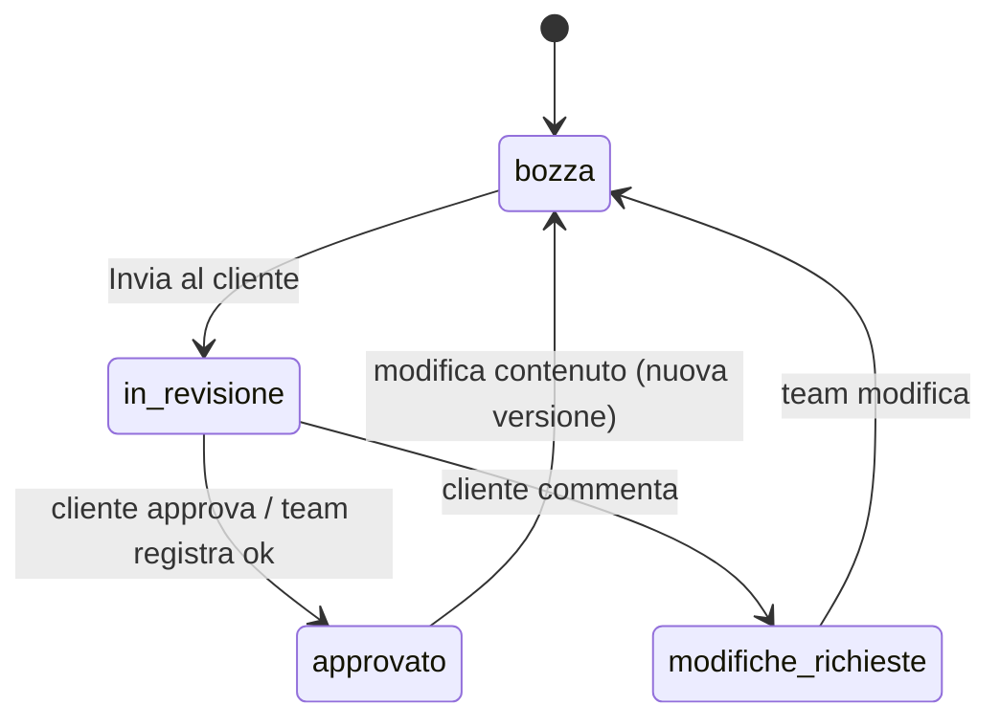

# Area admin e portale clienti

## Struttura

| Percorso | Contenuto |
|---|---|
| `core/` | `Api` (HTTP → Promise + `ApiError`), `AuthService` (sessione in Signal, refresh silenzioso), `authInterceptor`, guard per ruolo, toast |
| `shared/` | badge, modale `<dialog>`, conferme, renderer Markdown sicuro, thread messaggi, vista documento, etichette/colori stati |
| `features/auth` | login, attivazione invito |
| `features/admin` | shell con sidebar, dashboard, progetti (+ schede), clienti, lead, utenti, registro |
| `features/portal` | elenco progetti, progetto (fasi, documenti, messaggi, appuntamenti), revisione documento |

## Rotte

- `/login`, `/invito/:token` — pubbliche (login redirige alla propria area se già autenticati).
- `/admin/**` — admin e staff (`utenti`, `log` solo admin).
- `/admin/progetti/:id/{,checklist,documenti,documenti/:docId,marketing,messaggi,accessi}` — stato condiviso in `ProjectStore`.
- `/portale/**` — solo clienti; con un solo progetto si apre direttamente il dettaglio.

## Flusso documento

L'approvazione completa automaticamente il task collegato in checklist. Export PDF = stampa del browser con stile dedicato.

Pagine correlate: [[modules/api-backend.md|API]], [[modules/application-modules.md|moduli landing]].
